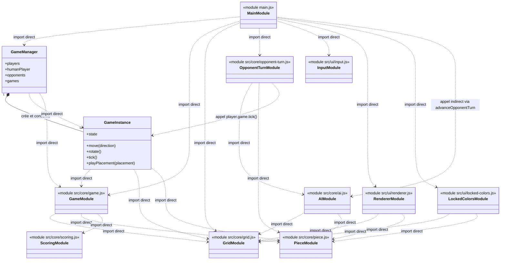
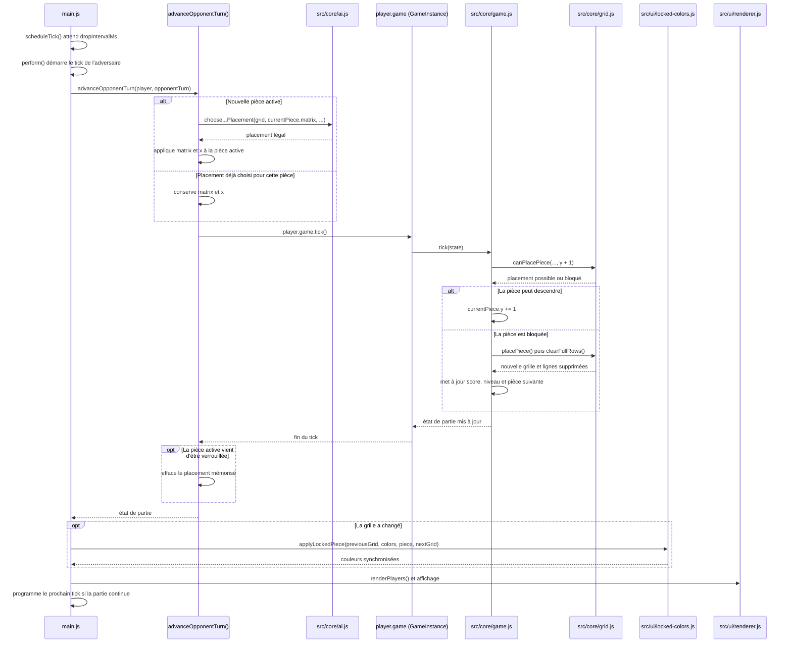

# Architecture du jeu

## Présentation générale

Le projet sépare les règles du jeu de leur affichage. Le dossier `src/core/`
contient le moteur et les données de partie, sans dépendre de la page ou du
Canvas. Le dossier `src/ui/` s'occupe du rendu et des commandes. Le fichier
`main.js` relie ces deux parties et gère le déroulement des parties dans le
navigateur.

Cette séparation permet au moteur d'être testé sans lancer l'interface.

## Rôle des principales parties

### `src/core/`

Ce dossier contient la logique du jeu :

- `game.js` crée l'état d'une partie, fait descendre les pièces et applique les
  déplacements, les rotations, les verrouillages et la fin de partie. Il fournit
  aussi `createSeededRandom` pour produire des parties reproductibles.
- `grid.js` crée la grille et vérifie les collisions et les placements. Il
  verrouille les pièces sur une copie de la grille et supprime les lignes
  complètes.
- `piece.js` définit les matrices des sept tétrominos et la fonction `rotate`.
- `scoring.js` calcule les points attribués aux lignes et le niveau.
- `game-instance.js` définit `GameInstance`, une interface autour de l'état d'une
  partie. Ses méthodes délèguent les règles au moteur.
- `game-manager.js` définit `GameManager`, qui crée le joueur humain et de zéro
  à trois adversaires. Chaque joueur reçoit une instance de jeu avec sa propre
  graine. Les adversaires reçoivent aussi un générateur de décisions dédié.
- `ai.js` énumère les placements légaux avec `findLegalPlacements`, puis permet
  de choisir un placement avec `chooseBeginnerPlacement`,
  `chooseIntermediatePlacement` ou `chooseExpertPlacement`.

### `src/ui/`

Ce dossier contient les éléments liés à l'interface :

- `input.js` relie les boutons et les touches du clavier à des fonctions
  fournies par `main.js`.
- `renderer.js` dessine une partie solo ou une à quatre parties dans leurs
  Canvas. Il affiche aussi les statistiques, l'état de la partie, l'aperçu de
  la prochaine pièce et les animations de lignes.
- `locked-colors.js` maintient les couleurs des pièces verrouillées en accord
  avec la grille binaire du moteur et fournit les lignes retirées pour
  l'animation.

### `main.js`

`main.js` initialise les éléments de la page, crée le `GameManager` et les
données nécessaires à l'affichage, puis relie le moteur, les IA et les modules
de l'interface. Il gère les minuteries de descente, la pause, le redémarrage, le
changement de mode et le choix de difficulté.

## Fonctionnement d'une partie solo

Au démarrage, `main.js` crée un `GameManager` sans adversaire et utilise l'état
de partie du joueur humain. `createRenderer` prépare l'affichage du plateau et
des statistiques.

Quand le jeu démarre, `scheduleTick` programme une descente après l'intervalle
indiqué par le niveau. Pour le joueur humain, cette étape appelle `tick` dans
`game.js`. Si la pièce ne peut plus descendre, le moteur la verrouille, supprime
les lignes complètes, met à jour le score et le niveau, puis crée la pièce
suivante. L'état obtenu est dessiné par `draw`.

## Mode multijoueur et IA

En mode multijoueur, `GameManager` crée le joueur humain et de un à trois
adversaires. Chaque joueur a sa propre `GameInstance`, donc sa grille, son score,
son état et son générateur de pièces sont indépendants. Les adversaires
utilisent la difficulté sélectionnée dans l'interface; le générateur
pseudo-aléatoire de l'IA Débutante est propre à chaque adversaire.

À chaque échéance, `scheduleTick` dans `main.js` appelle
`advanceOpponentTurn` avec le joueur et l'état de son tour. Pour chaque nouvelle
pièce, cette fonction choisit un placement avec la stratégie correspondant à sa
difficulté :

- **Débutant** choisit au hasard parmi les placements légaux.
- **Intermédiaire** choisit un placement selon une heuristique qui favorise les
  lignes complètes et pénalise les trous et la hauteur.
- **Expert** évalue les placements avec la hauteur cumulée, les lignes
  supprimées, les trous et l'irrégularité des colonnes. Si le type de la
  prochaine pièce est présent dans l'état de la partie, il peut aussi tenir
  compte d'un placement pour cette pièce.

L'IA fournit une position finale légale sans modifier la grille. Le contrôleur
applique la rotation choisie et la position horizontale à la pièce active, puis
appelle `GameInstance.tick()`. La pièce descend ainsi d'une case à chaque
échéance, comme celle du joueur humain. Le contrôleur conserve le même placement
pendant la descente et choisit à nouveau lorsque le moteur crée la pièce
suivante. `GameInstance.tick()` délègue au moteur, qui vérifie les collisions et
verrouille la pièce lorsqu'elle ne peut plus descendre; le moteur gère ensuite
les lignes, le score, le niveau et la fin de partie.

Chaque joueur possède sa propre minuterie. Mettre le jeu en pause, le reprendre
ou terminer une partie agit sur les minuteries et états correspondants.
`createMultiplayerRenderer` affiche les grilles, le rôle et la difficulté des
joueurs, ainsi que leurs statistiques et leur état.

## D'une commande clavier au rendu

`bindInput` dans `src/ui/input.js` écoute les flèches et la touche P. Pour une
commande de déplacement, de rotation ou de descente, `main.js` retrouve le
joueur humain et appelle `perform`. En mode solo, `perform` utilise directement
les fonctions du moteur; en multijoueur, il appelle la méthode correspondante
de l'instance du joueur humain. Les adversaires ne reçoivent pas ces commandes.

Après l'action, `perform` appelle `draw`. Si la grille a changé parce qu'une
pièce a été verrouillée, `syncLockedColors` met à jour les couleurs via
`applyLockedPiece` et lance l'animation des lignes supprimées. `draw` choisit
ensuite le rendu solo ou multijoueur.

## Relations entre les modules

## Étapes principales d'un tour

